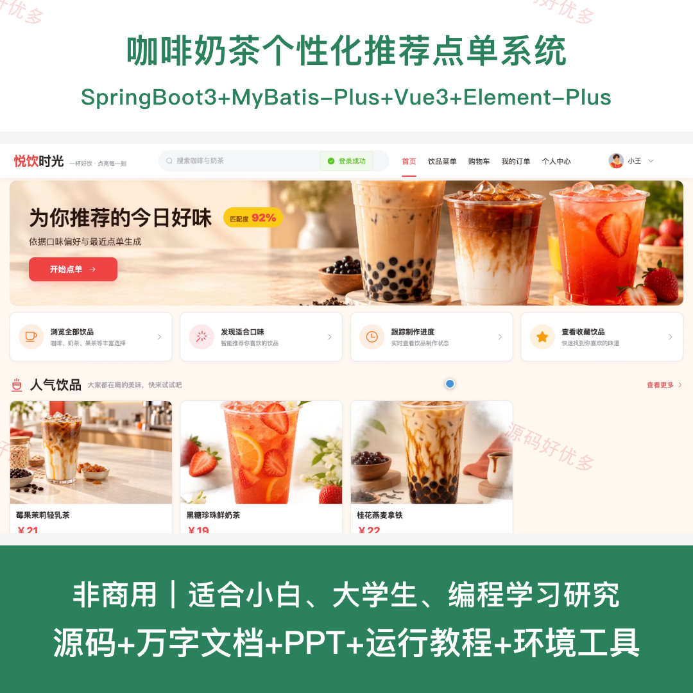
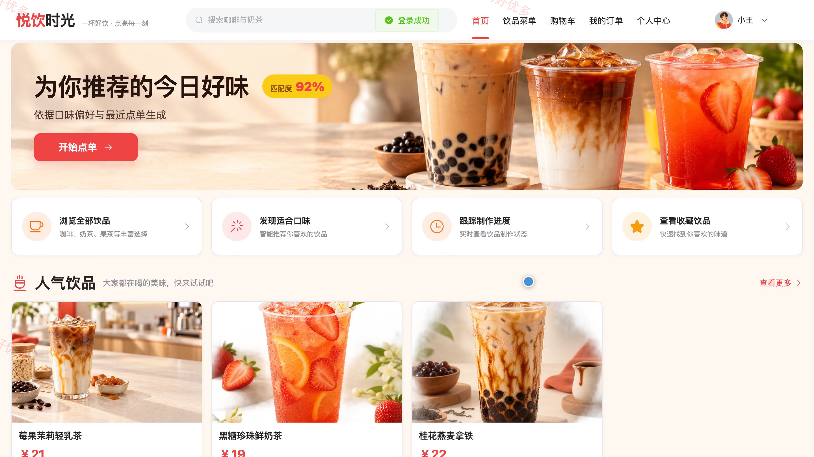
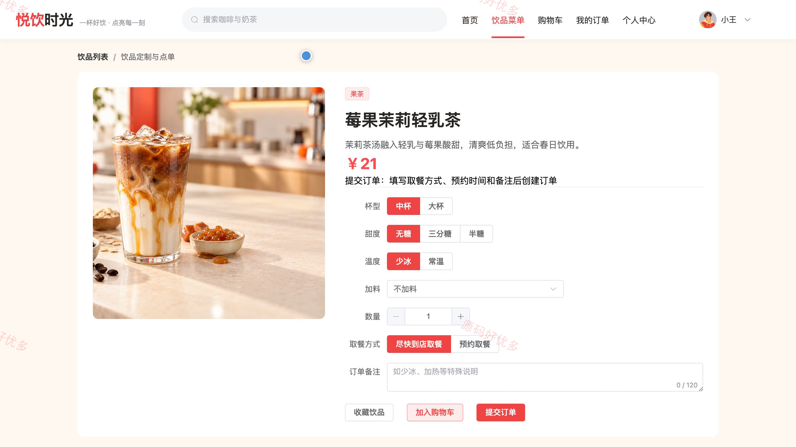
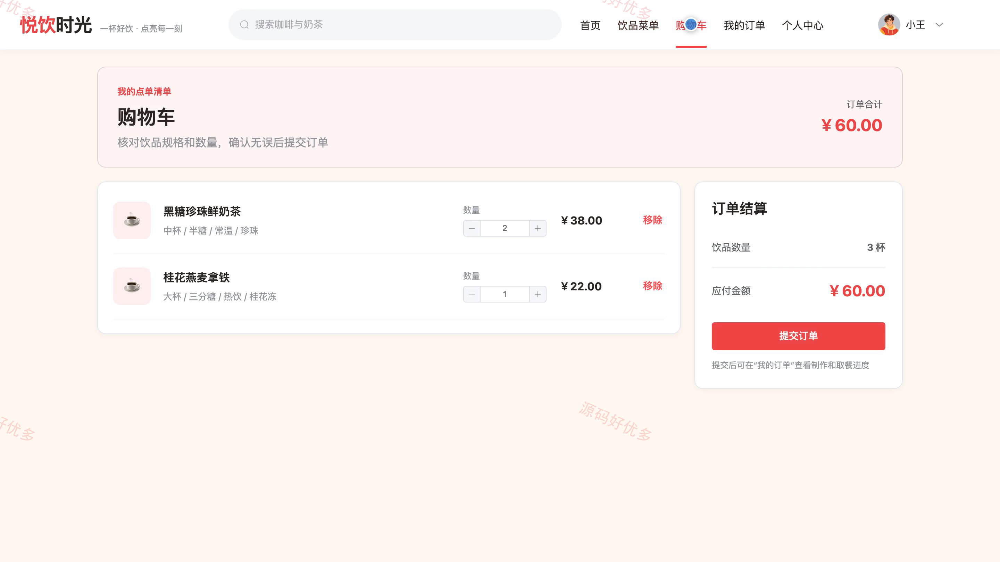
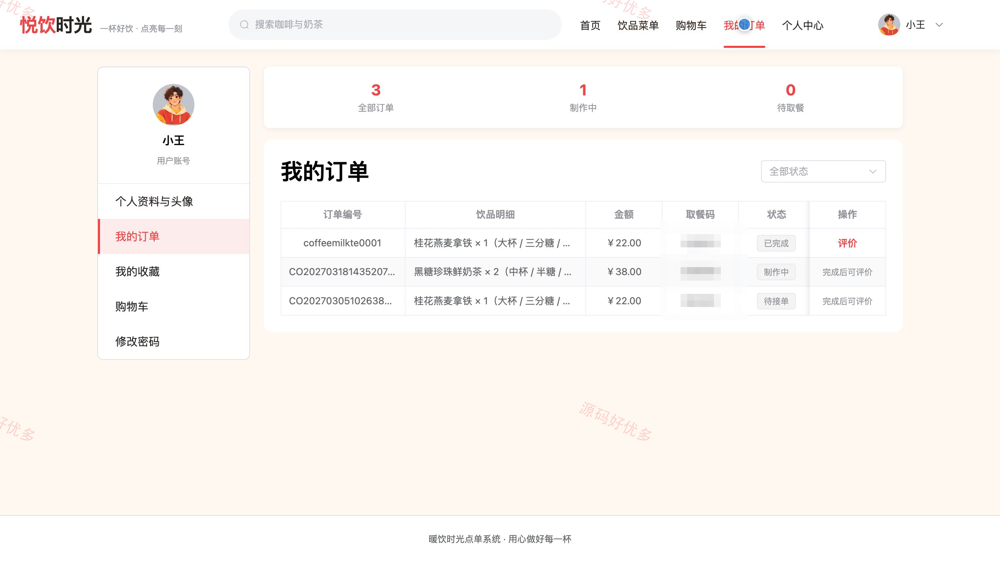
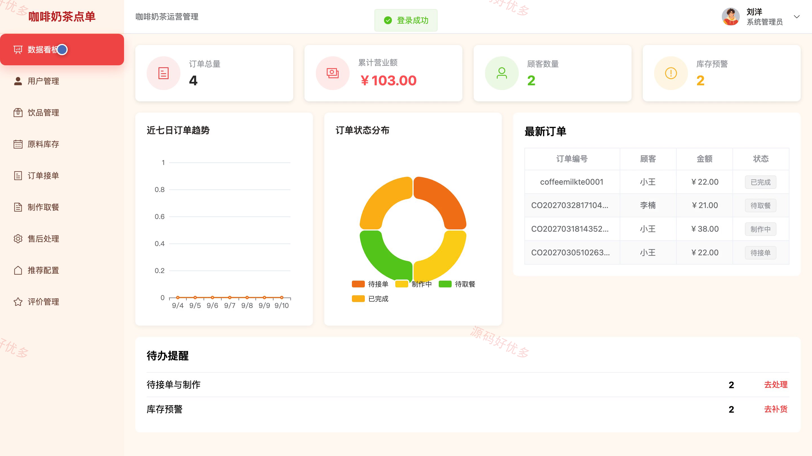
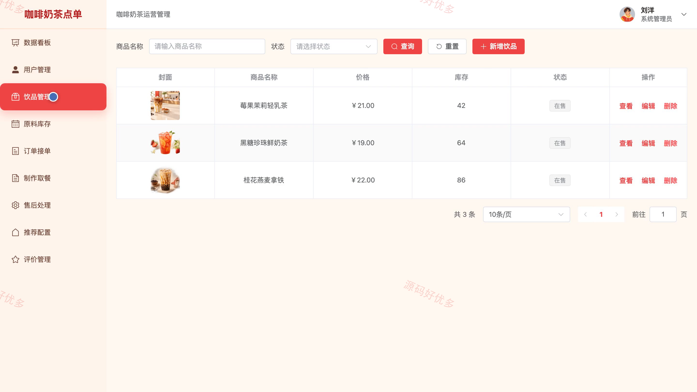
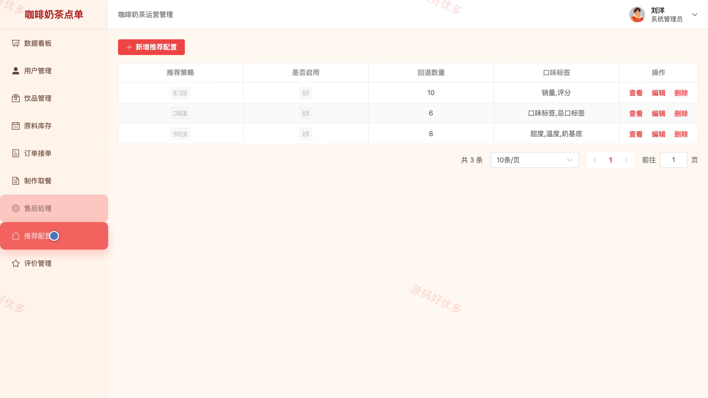
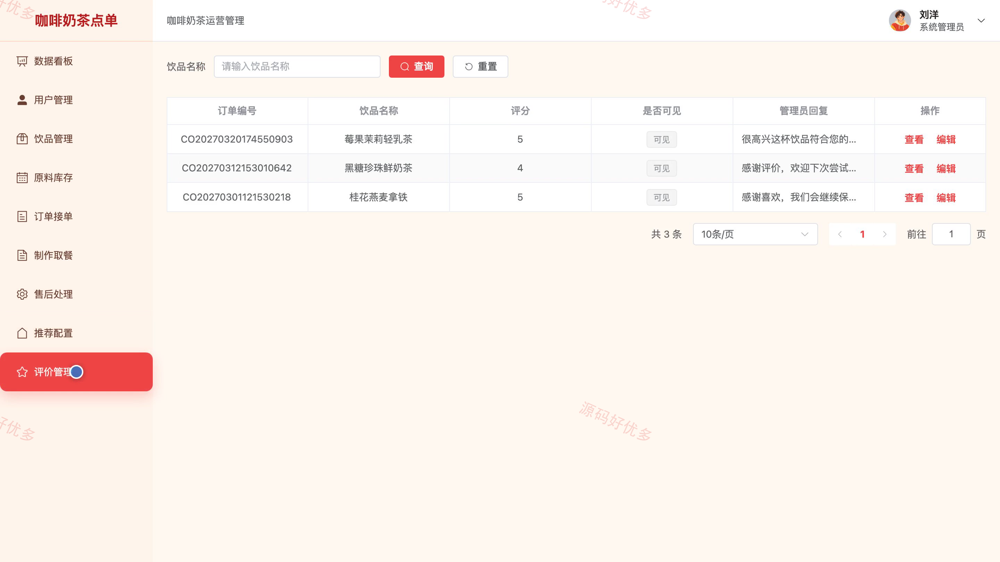

# bs121A
bs121A咖啡奶茶个性化推荐点单系统
## 源码问题查看主页咨询

### 一、关键词
咖啡点单、奶茶点单、饮品推荐、饮品定制、在线点餐

### 二、作品包含
源码+数据库+万字设计文档+PPT+全套环境和工具资源+本地部署教程

### 三、项目技术
前端技术： Html、Css、Js、Vue3.4、Element-Plus
后端技术：Java、SpringBoot3.2.0、MyBatis-Plus

### 四、运行环境要求
开发工具：IDEA/eclipse + VSCODE

数据库：MySQL5.7+（共14张表）

数据库管理工具：Navicat10以上版本

环境配置软件： JDK17 + Maven3.6

前端Nodejs：16+

浏览器：谷歌浏览器

### 五、项目介绍
项目编号：bs121A

咖啡奶茶个性化推荐点单系统面向顾客和系统管理员，覆盖口味偏好、饮品推荐、规格定制、购物车、订单履约、库存预警、售后与经营统计等业务，为顾客提供个性化饮品点单体验。

角色：顾客、系统管理员

顾客功能：口味偏好设置、饮品浏览与个性化推荐、饮品规格定制、购物车管理、订单提交与跟踪、收藏管理、订单评价。

系统管理员功能：经营数据看板、顾客账号管理、饮品分类与商品管理、原料库存与预警、订单接单与制作取餐、售后处理、推荐配置、评价管理。

### 六、运行截图

